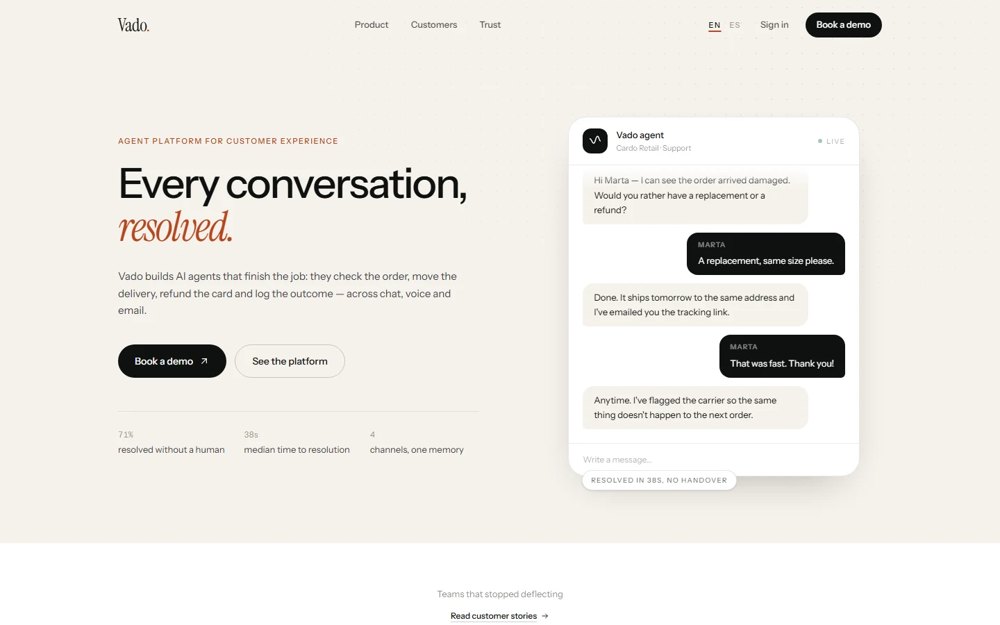

# Vado — AI Agents for Customer Experience

Every conversation, resolved. A bilingual product landing page for an AI agent platform that finishes the job instead of handing the customer to a human.



## Overview

Vado is a single-page product site built around one claim: an agent that resolves. Nine sections — navigation, hero with a live conversation demo, customer wall, product features, testimonials, the agent platform (dashboard, studio, measurement, memory), trust, closing call to action and footer — composed as a calm, typographic system with a single clay accent.

Everything is statically generated in English and Spanish, every visual is CSS or SVG, and no asset is fetched from a third party at runtime.

## Key Features

- **Bilingual routing (`en` / `es`)**: Typed dictionaries, `/[locale]` segments, `Accept-Language` negotiation and a `vado.locale` cookie that remembers the visitor's choice.
- **A real type scale**: Tailwind v4 `@theme` tokens (`text-display`, `text-section`, `text-eyebrow`) driving every heading, with paired line-height and tracking.
- **Animated conversation demo**: The hero chat reveals messages on a timer, shows a typing indicator and loops. It renders fully expanded when the visitor prefers reduced motion.
- **Product illustrations without images**: The dashboard, studio panels, charts and trace views are hand-built with divs and inline SVG, so they stay crisp and weigh nothing.
- **Consistent metadata**: Canonical URLs, `hreflang` alternates with `x-default`, per-locale OpenGraph tags, a multilingual sitemap and a 1200×630 card generated at request time.
- **Accessible navigation**: The mobile menu is keyboard operable, closes on `Escape`, locks background scroll and exposes `aria-expanded`/`aria-controls`. Illustrative product UI is hidden from assistive technology.
- **Localised 404**: A `[locale]/[...rest]` catch-all routes unknown paths into the styled not-found page.

## Tech Stack

- **Framework**: Next.js 16.4.3 (App Router, Turbopack)
- **Library**: React 19.3
- **Language**: TypeScript 5.7.3 (strict)
- **Styling**: Tailwind CSS 4.3.3 with CSS-first `@theme` tokens
- **Motion**: Framer Motion 14 (respecting `MotionConfig reducedMotion="user"`)
- **Analytics**: `@vercel/analytics`
- **Package Manager**: pnpm 11.17

## Architecture

```
vado-ai/
├── docs/
│   ├── provenance.md          # Compliance ledger and transformation history
│   └── screenshot.webp        # Visual preview artifact
├── src/
│   ├── app/
│   │   ├── [locale]/
│   │   │   ├── [...rest]/page.tsx   # Catch-all that renders the 404
│   │   │   ├── layout.tsx     # Locale shell, font variables, analytics
│   │   │   ├── not-found.tsx  # Styled 404
│   │   │   ├── opengraph-image.tsx   # 1200x630 social card
│   │   │   └── page.tsx       # Composed landing route
│   │   ├── globals.css        # Design tokens and base layers
│   │   ├── icon.svg           # Waveform brand mark
│   │   ├── robots.ts
│   │   └── sitemap.ts
│   ├── components/
│   │   ├── landing/
│   │   │   ├── agent-os/      # Platform section, dashboard and panels
│   │   │   ├── chat-demo.tsx
│   │   │   ├── cta.tsx
│   │   │   ├── features.tsx
│   │   │   ├── footer.tsx
│   │   │   ├── hero.tsx
│   │   │   ├── logo-wall.tsx
│   │   │   ├── navigation.tsx
│   │   │   ├── resolution-visual.tsx
│   │   │   ├── reveal.tsx
│   │   │   ├── testimonials.tsx
│   │   │   └── trust.tsx
│   │   ├── button.tsx
│   │   ├── icons.tsx
│   │   ├── kit.tsx            # Container, Section, Eyebrow, SectionTitle
│   │   └── motion-provider.tsx
│   ├── config/site.ts
│   ├── i18n/
│   │   ├── config.ts
│   │   ├── dictionaries/      # Typed English and Spanish copy
│   │   └── get-dictionary.ts
│   ├── lib/
│   │   ├── motion.ts
│   │   ├── seo.ts
│   │   └── utils.ts
│   └── proxy.ts               # Locale detection and persistence
├── eslint.config.mjs
├── next.config.ts
├── package.json
└── tsconfig.json
```

## Getting Started

### Prerequisites

- Node.js >= 20.9.0
- pnpm >= 10.0.0

### Installation

```bash
git clone https://github.com/JORDANROBERTO74/vado-ai.git
cd vado-ai
pnpm install
```

### Development

```bash
pnpm dev
```

Visit [http://localhost:3000](http://localhost:3000). The root redirects to `/en` or `/es` based on the request.

### Quality Checks

```bash
pnpm typecheck   # TypeScript, no emit
pnpm lint        # ESLint flat config
pnpm build       # Production build
```

## Deployment

The site is deployed on Vercel with the default Next.js preset. Import the repository, or run:

```bash
vercel deploy --prod
```

Set `NEXT_PUBLIC_SITE_URL` when serving from a custom domain; otherwise the canonical URL falls back to `https://vado-ai.vercel.app`.

## Performance & SEO

- `/en` and `/es` are statically generated; only the locale negotiation runs at the edge.
- No images, no icon packs and no animation libraries beyond Framer Motion: the whole page is HTML, CSS and inline SVG.
- Fonts are bundled at build time by `next/font` with automatic size-adjust metrics, so there is no layout shift and no request to a font CDN.
- `sitemap.xml` and `robots.txt` derive from the locale configuration.
- OpenGraph and Twitter cards are generated from the same dictionaries as the page, so titles never drift.

## Accessibility

- Semantic landmarks (`header`, `nav`, `main`, `section`, `footer`) and a single `h1` per locale.
- Skip link, visible focus rings and a keyboard-operable mobile menu that closes on `Escape`.
- Product illustrations are marked `aria-hidden`, so screen readers hear the narrative, not fake UI.
- Motion is driven by `MotionConfig reducedMotion="user"` plus a global `prefers-reduced-motion` rule.
- Colour pairs (ink on paper, paper on clay, paper on ink) meet WCAG AA.

## Compliance & Licensing

This project was rebuilt under clean-room principles:

- No third-party trademarks, logos, real executives, stock photography or celebrity likenesses.
- Company names, people and quotes in the customer wall and testimonials are fictional.
- The compliance badges are neutral, original marks; they reproduce no certification seal and are labelled as illustrative.
- The full audit trail lives in [`docs/provenance.md`](docs/provenance.md).

## License

This project is licensed under the MIT License — see the [LICENSE](LICENSE) file for details.
